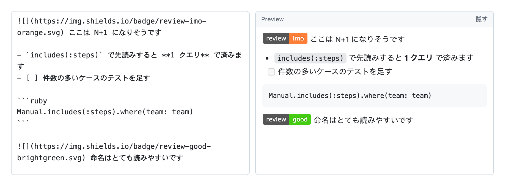

# GitHub Helper

GitHub を便利にする Chrome 拡張です。いまは次の2つができます。

- コメント欄の隣に Preview を常時表示する
- `/imo` と入力してスペースを押すと、shields.io のレビューバッジの Markdown に変換する



```
/imo␣  →  
```

## インストール

1. Chrome で `chrome://extensions` を開く
2. 右上の「デベロッパー モード」をオンにする
3. 「パッケージ化されていない拡張機能を読み込む」でこのディレクトリを選択
4. GitHub のタブを開き直す（既に開いているタブはリロードが必要）

## 使い方

PR のレビューコメント欄・Issue・コミットコメントなど、GitHub 上のテキストエリアで動きます。

| 入力 | 変換結果 |
| --- | --- |
| `/must␣` |  |
| `/imo␣` |  |
| `/nits␣` |  |
| `/ask␣` |  |
| `/fyi␣` |  |
| `/good␣` |  |

### 入力候補

`/n` のように1文字でも打つと、カーソルの下にバッジの候補が出ます。

- <kbd>↑</kbd> <kbd>↓</kbd> … 候補を選ぶ
- <kbd>Tab</kbd> / <kbd>Enter</kbd> … 選択中のバッジを挿入（末尾にスペースが付きます）
- <kbd>Esc</kbd> … 閉じる
- クリックでも挿入できます

候補のバッジは CSS で描いた擬似表示です（GitHub の CSP で `img.shields.io` を直接読み込めないため）。挿入される Markdown は本物の shields.io の URL です。

### Preview を隣に並べる

コメント欄の隣に Preview が常時表示され、Write / Preview タブを行き来せずに仕上がりを確認できます
（冒頭のスクリーンショットのような見た目になります）。

- **入力欄には一切手を加えません**。GitHub の `textarea` はそのまま残り、値を読み取って隣に描画するだけ
  なので、Submit・下書き保存・GitHub 純正の Preview タブはすべて元のまま動きます。
- **場所に合わせて並び方を決めます**。まず横並びを試し、実際の描画を測って Preview が細く
  （280px 未満）なったり段が崩れたりしたら、自動で下に全幅で積み直します。GitHub のインライン
  レビュー欄のように幅が狭いところでは下に積まれます。
- Write のスクロールに合わせて Preview もスクロールします。
- 見出し・箇条書き・ネスト・タスクリスト・番号付きリスト・引用・コードブロック・水平線・
  強調・インラインコード・打ち消し・リンク・バッジに対応しています。
- バッジは CSS で描いた擬似表示です（GitHub の CSP で `img.shields.io` を直接読めないため）。
  バッジ以外の画像も読み込めないので、`🖼 alt` のように名前だけ表示します。
- Preview の見出しの右端にある **隠す / 出す** ボタンで、その欄だけ切り替えられます。
  隠すと見出しの細い帯だけが入力欄の下に残り、入力欄は全幅に戻ります。
  全体で止めたいときはオプション画面のチェックを外してください。

### 変換のルール

- 変換のトリガーはトークンの直後の **スペースまたは改行**、または候補からの <kbd>Tab</kbd> / <kbd>Enter</kbd> です。`/important` のような単語を打っている途中では勝手に変換されません。
- `app/imo` のようにパスの一部になっている場合は変換しません（直前の文字が英数字・`.` `/` `-` のときは無視）。
- 入力の大文字小文字は区別しません。バッジの表記は設定に書いたラベルが使われます（`/fyi` と打っても `FYI` と出ます）。
- 未登録のラベルはそのまま残ります。
- 変換は `document.execCommand('insertText')` 経由なので、`Cmd+Z` で元に戻せます。
- 入力欄の中身を書き換えるのはこの変換だけで、それ以外に textarea へ触ることはありません。

## 設定

`chrome://extensions` の「拡張機能のオプション」から、

- 変換の有効 / 無効
- Preview の常時表示の有効 / 無効
- バッジの左ラベル（既定は `review`）
- ラベルと色の組み合わせ（`ラベル,色` を1行ずつ）

を変更できます。色は shields.io が受け付ける名前か 16 進数（例: `orange`、`ff69b4`）です。

## GitHub Enterprise で使う場合

`manifest.json` の `content_scripts[0].matches` に自社ドメインを追加して読み込み直してください。

```json
"matches": ["https://github.com/*", "https://github.example.com/*"]
```

## 補足

コメント欄の先頭で `/` を打つと GitHub 自身のスラッシュコマンド候補が出ますが、続けて `imo` まで打てば GitHub 側の候補は消え、この拡張のプレビューだけが残ります。プレビューが出ている間は <kbd>Tab</kbd> / <kbd>Enter</kbd> / <kbd>↑</kbd> <kbd>↓</kbd> を横取りするので、GitHub 側の候補が誤って確定されることはありません。

## ファイル構成

```
manifest.json           拡張機能の定義（MV3）
content.js              github.com 上で動く変換ロジックと Preview の描画
content.css             Preview と候補のスタイル（拡張機能の CSS はページの CSP を受けない）
options.html            設定画面
options.js              設定の保存・復元とバッジのプレビュー
test/local-test.html    拡張機能を入れずに挙動を試すためのページ
docs/preview.png        README のスクリーンショット
```

## 開発時の動作確認

`test/local-test.html` を Chrome で直接開くと、`chrome.storage` をスタブした状態で content.js の挙動
（変換・候補プレビュー・キー操作・隣の Preview）を確認できます。横並びになる広い欄と、
下に積まれる狭い欄の両方を置いてあります。
